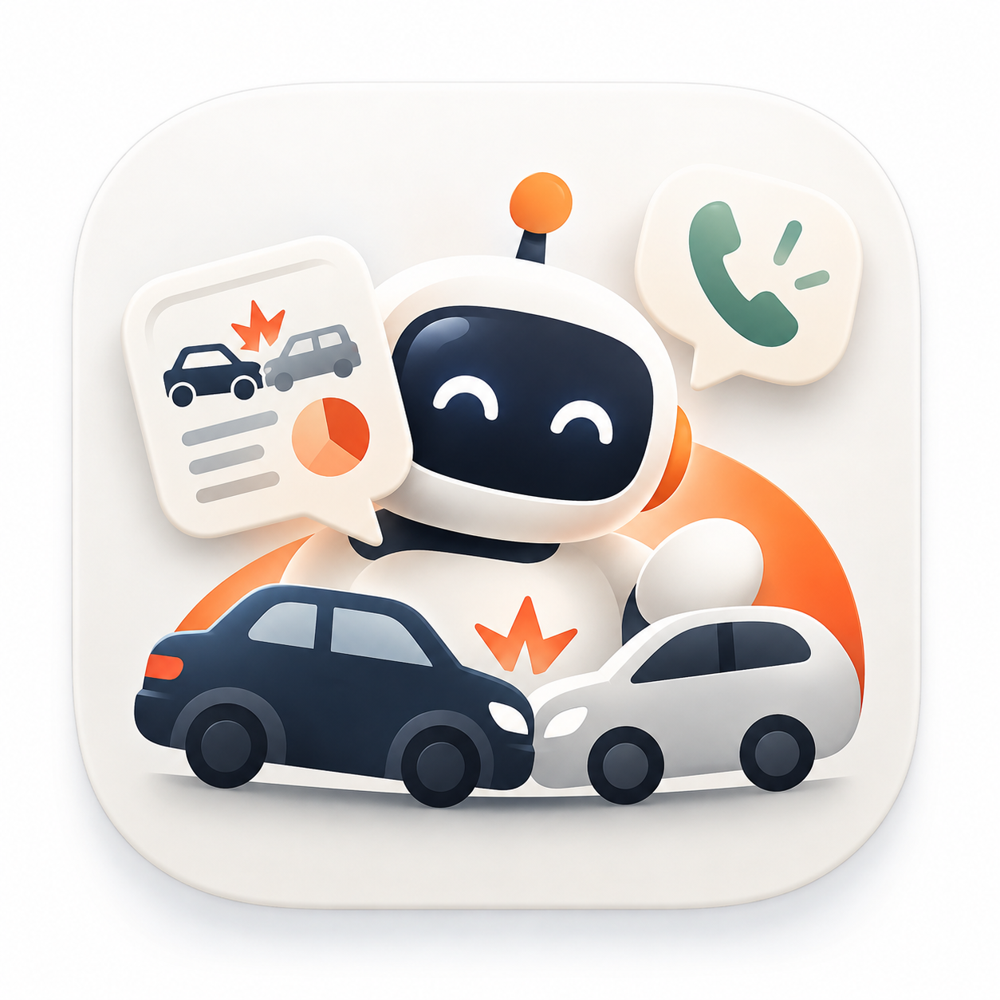
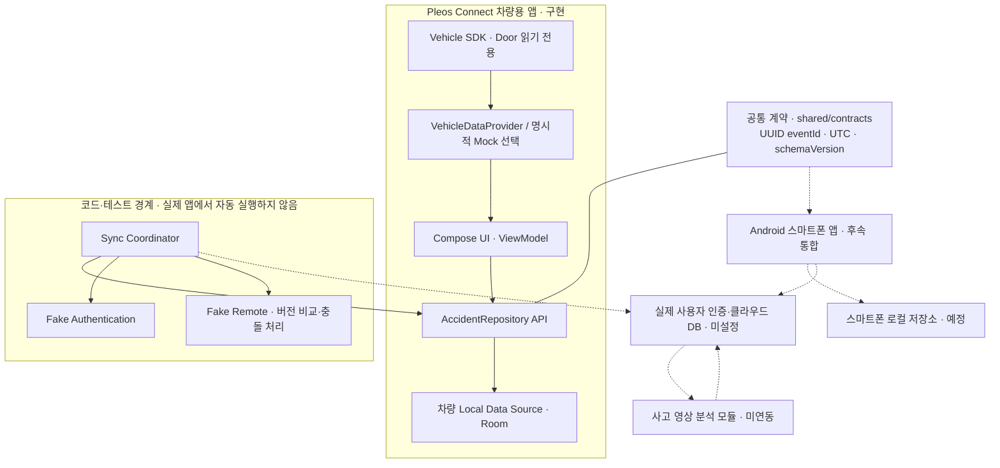
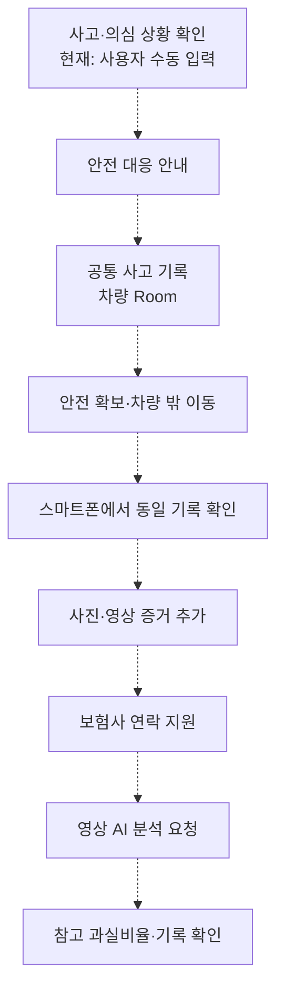

<div align="center">
  
  <h1>CheckMate</h1>
  <p><strong>사고의 순간, 확인부터 대응까지.</strong></p>
  <p>차량과 스마트폰을 연결하는 교통사고 대응 지원 서비스</p>
  <p>Hyundai Motor Group App Development Challenge 참가 프로젝트</p>
  <p align="center">
    
    
    
    
    
  </p>
</div>

> **현재 개발 단계: Phase 3A — 공통 사고 데이터·로컬 저장·동기화 기반 구현.** 차량 앱의 Pleos Door 어댑터와 Room 저장소, 공통 JSON 계약, Fake 기반 인증·동기화 테스트를 구현했습니다. 실제 Pleos 실행, 스마트폰·클라우드 통신, 영상 분석은 검증 완료 또는 실제 연동 상태가 아닙니다.

**목차**

[프로젝트 소개](#프로젝트-소개) · [핵심 가치](#핵심-가치) · [주요 기능](#주요-기능) · [앱별 역할](#앱별-역할) · [시스템 아키텍처](#시스템-아키텍처) · [사고 대응 시나리오](#사고-대응-시나리오) · [기술 스택](#기술-스택) · [개발 현황](#개발-현황) · [저장소 구조](#저장소-구조) · [설치 및 실행](#설치-및-실행) · [테스트 및 검증](#테스트-및-검증) · [팀과 협업](#팀과-협업) · [향후 계획](#향후-계획) · [제한사항 및 참고자료](#제한사항-및-참고자료)

## 프로젝트 소개

CheckMate는 **교통사고 발생 후 운전자가 필요한 조치를 확인하고, 차량과 스마트폰에서 사고 처리 과정을 이어가도록 돕는 서비스**입니다. 안전 대응 안내, 사고 기록 관리, 보험사 연락 보조와 사고 영상 기반의 예상 과실비율 참고 제공을 목표로 합니다.

차량용 앱은 사고 직후의 간단한 확인과 안전 대응에, 스마트폰 앱은 현장 증거 확보와 사고 이후의 상세 업무에 집중합니다. **스마트폰 블랙박스는 선택 기능**입니다. 녹화 없이도 수동 사고 신고와 대응 안내를 이용하고, 기존 영상으로 분석을 요청할 수 있는 구조를 지향합니다. 현재 구현은 차량 측 기반과 공통 계약까지이며 실제 모바일·영상 분석 기능은 후속 작업입니다.

공식 아이콘은 사고 순간에 사용자를 돕는 보조자이자 협력자, **스마트 사고 대응 파트너**를 뜻합니다. 사고 대응·연락·기록·분석이라는 브랜드 방향을 표현하며, 해당 기능의 실제 구현 범위는 아래 현황을 따릅니다. README는 [원본 PNG](docs/assets/checkmate-icon.png)를 사용하고 Android 앱은 같은 원본의 런처용 변환본을 사용합니다. 원본과 변환 리소스의 관계는 [아이콘 문서](android-vehicle/docs/APP_ICON.md)에 정리했습니다.

## 핵심 가치

- **사고 직후 필요한 순서 안내:** 탑승자 안전, 주변 교통·2차 사고 위험, 신고, 증거와 보험사 연락을 차례로 확인합니다.
- **차량에서 스마트폰으로 이어지는 기록:** 동일한 사고 ID를 사용해 두 앱에서 처리 과정을 이어가는 것이 목표입니다.
- **연결 실패에도 기본 대응 유지:** 기본 안전 안내와 로컬 기록은 네트워크에 의존하지 않습니다. 상세 조작에는 검증된 정차 조건을 적용합니다.
- **분석의 한계 표시:** 결과 없음·실패·Mock 예시를 구분하며, 과실비율을 법적 확정 결과로 제시하지 않습니다.

## 주요 기능

`구현`은 코드가 존재한다는 의미이며 실제 기기 검증까지 완료했다는 뜻은 아닙니다. `Fake/Mock`은 개발용 모사이며 실제 서비스 연동과 구분합니다.

| 기능 | 현재 상태 | 구현 범위와 남은 작업 |
| --- | --- | --- |
| 차량 상태·연결 관리 | 구현 / 실환경 검증 필요 | Vehicle SDK 초기화, 앞좌석 왼쪽 Door Position 읽기·구독, 재시도·해제·신선도 처리 |
| 수동 사고 대응·확인·취소 | 구현 | UUID 사건 생성, 사고 확인·오탐 이력, SDK 연결 없이 기본 대응 진입. 자동 사고 감지는 미연동 |
| 단계별 안전 안내 | 구현 | 6단계 안내와 순서별 확인, 오프라인 접근. 버튼은 실제 신고·접수 완료를 뜻하지 않음 |
| 사고 기록·진행 상태 저장 | 구현 / 실기기 검증 필요 | 차량 앱의 Room 영속 저장, 대응 단계·분석·동기화 메타데이터. 사진·영상 원본 저장은 없음 |
| 공통 데이터·동기화 기반 | Fake 기반 구현 | JSON Schema·codec, Fake 인증·Remote, 버전 비교·재전송·사용자 격리·충돌 보존. 실제 기기 간 통신은 없음 |
| 보험사 연락 지원 | 계획 | 현재는 안내 문구와 `InsuranceContact` 모델만 존재. 연락처 등록·표시·전화 연결·자동 접수는 미구현 |
| AI 유형·참고 과실비율 | Mock 구현 / 실제 모델 미연동 | 명시적으로 선택한 고정 예시와 결과 없음·실패 상태. 실제 영상 분석·성능 결과 없음 |
| 현장 증거·보고서·선택적 녹화 | 계획 | 증거·보고서 모델 및 메타데이터 계약. 실제 촬영·녹화·파일 보존·보고서 생성·내보내기는 미구현 |

## 앱별 역할

아래 역할은 서비스의 목표 범위입니다. 스마트폰 기능과 실제 앱 간 연동이 구현되었다는 의미는 아닙니다.

| 구성 | 목표 역할 | 현재 확인된 범위 |
| --- | --- | --- |
| Pleos Connect 차량용 앱 | 차량 상태, 사고 직후 안전 확인·대응 안내, 보험사 연락 정보, 기록·AI 결과 요약 | 상태 표시·수동 대응·안내·Room 기록·Mock 분석 UI 구현. 연락처 표시·실제 AI는 미구현 |
| Android 스마트폰 앱 | 차량 사고 기록 확인, 수동 신고, 현장 사진·영상 확보, 보험사 전화 연결, 처리 정보 추가, 상세 AI 결과·기록 보관 | 공통 계약·역할 설계. 별도 `mobile-app` 브랜치의 초기 구조와 실제 기능 통합은 구분하며 이 브랜치에는 모바일 앱 없음 |
| 선택적 스마트폰 블랙박스 | 사용자가 선택한 경우 주행 영상 확보 | CameraX·센서·녹화·사고 전후 영상 보존 미연동. 전체 서비스의 필수 전제 아님 |
| 공통 데이터·향후 서버 | 같은 사고 ID, 기기별 로컬 저장, 인증된 사용자별 클라우드 기록과 양방향 동기화 | 차량 Room·공통 계약·Fake 테스트 구현. 모바일 로컬 저장·운영 인증·공유 DB는 예정 |
| 사고 영상 분석 모듈 | 사고 유형·근거·예상 과실비율을 참고 정보로 제공 | 계약·모델 검토 단계. 현재 고정 Mock 결과만 제공 |

## 시스템 아키텍처



**실선은 구현된 내부 계층·계약 참조·Fake 테스트 경로, 점선은 향후 연동 경로**입니다. 차량과 스마트폰이 이미 통신하거나 공통 클라우드 DB를 사용한다는 뜻이 아닙니다. Firebase Authentication·Cloud Firestore는 후보이며 확정된 인프라가 아닙니다.

공통 사고 키는 기존 UUID `eventId`입니다. `DataSource.MOCK/PLEOS`는 차량 데이터 출처, `EventOrigin`은 차량 수동·스마트폰 수동·센서·Demo 등의 사고 생성 주체를 나타냅니다. 시각은 UTC ISO 8601, 공통 envelope는 `schemaVersion=1`을 사용합니다.

실제 미디어 파일과 메타데이터를 분리하며 원본 영상·사진·파일 URI·위치 좌표·보험사 개인정보·인증 토큰을 사고 JSON에 넣지 않습니다. 동기화는 수정 시각만으로 덮어쓰지 않고 버전·작업 ID를 검사합니다. 동시 수정·삭제·증거 충돌은 보존합니다.

[공통 계약](shared/contracts/README.md) · [JSON Schema](shared/contracts/accident-event.schema.json) · [JSON 예제](shared/contracts/accident-event.example.json) · [연동 구조](docs/architecture/integration-overview.md) · [DB 설계](docs/architecture/database-design.md) · [동기화 정책](docs/architecture/sync-policy.md)

## 사고 대응 시나리오

다음은 **최종 목표 시나리오**입니다. 현재 차량 앱의 수동 흐름은 사고 기록 생성 → 사고 확인 → 안전 안내 순서이며, 기본 안전 안내는 사고 생성 없이도 열 수 있습니다.

| 단계 | 사용자 흐름 | 현재 상태 |
| --- | --- | --- |
| 1 | 차량에서 사고 발생·의심 상황 확인 | 사용자의 수동 사고 대응 진입 구현, 자동 감지는 미연동 |
| 2 | 차량 화면에서 안전 대응 절차 안내 | 6단계 가이드 구현 |
| 3 | 공통 사고 기록 생성·보관 | 차량 Room·공통 계약 구현 |
| 4 | 안전을 확보하고 차량 밖으로 이동 | 행동 안내 범위. 앱이 이동·안전 확보를 판정하지 않음 |
| 5 | 스마트폰에서 동일한 사고 기록 확인 | 실제 앱 간 연동 예정 |
| 6 | 현장 사진·영상 등 증거 추가 | 메타데이터 계약, 실제 파일 기능 예정 |
| 7 | 보험사 연락 지원 | 안내만 제공, 전화 연결·접수 예정 |
| 8 | 사고 영상 AI 분석 요청 | 실제 모델·파일 전송 예정 |
| 9 | 예상 과실비율·사고 기록 확인 | 차량의 Mock 화면·로컬 기록 구현, 실제 분석·스마트폰 상세 조회 예정 |



이 시나리오 다이어그램의 화살표는 목표 사용자 순서이며 현재 구현의 호출 순서나 앱 간 연결을 뜻하지 않습니다.

안전 가이드는 **탑승자 안전 → 주변 교통·2차 사고 위험 → 긴급 신고 안내 → 영상·위치 기록 확인 → 보험사 연락 안내 → 사고 기록 확인** 순서입니다. 분석 결과를 기다리지 않고 안내를 제공하며, 결과가 없을 때 임의의 비율을 만들지 않습니다.

## 기술 스택

| 영역 | 현재 코드의 기술·설정 |
| --- | --- |
| 언어·런타임 | Kotlin Compose plugin 2.2.10, Java 17 |
| UI | Jetpack Compose, Material 3, Compose BOM 2026.02.01 |
| 구조·상태 | MVVM, ViewModel, StateFlow, Coroutines 1.9.0 |
| Android | minSdk 28 / compileSdk 37 / targetSdk 35, 앱 버전 0.1.0 |
| 차량 SDK | `ai.pleos.playground:Vehicle:2.3.2`, 읽기 전용 Door 어댑터 |
| 로컬 저장 | Room 2.6.1, Java Entity·DAO·Database와 javac annotationProcessor |
| 공통 데이터 | JSON Schema, Gson 2.11.0의 명시적 JSON codec |
| 빌드·검증 | Gradle 9.5.0, AGP 9.3.3, JUnit 4, kotlinx-coroutines-test, Android Lint |

설정 원본: [앱 Gradle](android-vehicle/app/build.gradle.kts) · [Version Catalog](android-vehicle/gradle/libs.versions.toml) · [Gradle Wrapper](android-vehicle/gradle/wrapper/gradle-wrapper.properties)

| 후보 기술 | 검토 목적 | 현재 상태 |
| --- | --- | --- |
| Firebase Authentication·Cloud Firestore | 사용자 인증·공유 DB | 미설정, 차량 환경 지원·보안 규칙·이용조건·비용 확인 후 결정 |
| CameraX·Android Sensors | 선택적 녹화·사고 의심 신호 | 구현·통합 예정 |
| Python·PyTorch | AI 학습·추론 | 모델·분석 서비스 미구현 |
| YOLO·XGBoost 등 | 객체·상황 특징과 참고 과실비율 추정 | 후보이며 최종 구조 미확정 |

개발 도구는 Android Studio, VS Code, Codex, Git·GitHub를 사용합니다.

## 개발 현황

| 단계 | 현재 범위 | 검증·후속 작업 |
| --- | --- | --- |
| Phase 0 — 개발 환경 | Android·Kotlin·Compose·SDK 의존성·빌드 설정 | 로컬 빌드 이력 |
| Phase 1 — 차량 앱 기반 | MVVM, 사고 확인·오탐, 6단계 가이드, 메모리 저장소, Mock 분석 UI | 당시 JVM 49개 통과. 현재는 Phase 3A 영속 저장소를 실제 앱에 연결 |
| Phase 2 — Pleos SDK | 초기화, Door 조회·구독, 연결 수명·재시도, 데이터 신선도·안전 처리 | 당시 JVM 93개 통과. Pleos 전용 에뮬레이터·차량 실행 미검증 |
| Phase 3A — 공통 사고 데이터·로컬 저장 | Room 영속 기록, 공통 JSON Schema·codec, Fake 인증·Remote·Sync Coordinator, UI 상태 | JVM 150개·Debug 빌드·Lint 이력 확인. 실제 Room 기기 재오픈 미실행 |
| Phase 3B — 실제 서비스 연동 | 운영 인증·클라우드 DB·스마트폰 양방향 동기화 | 계획. 인프라·보안 규칙·모바일 환경 준비 후 구현 |
| 이후 — 영상·AI·통합 | 선택적 녹화·현장 증거, 실제 AI, 보고서·통합 시연 | 계획. 성능·릴리스 완료를 주장하지 않음 |

구현 이력: [초기 SDK 설정](https://github.com/WhiteBearCode02/CheckMate/commit/317c186) · [Phase 1 기반 구현](https://github.com/WhiteBearCode02/CheckMate/commit/a5858da2f63c5160af7f2c7207a0deb16956718a) · [Phase 1 PR #2](https://github.com/WhiteBearCode02/CheckMate/pull/2) · [Phase 2 PR #3](https://github.com/WhiteBearCode02/CheckMate/pull/3) · [Phase 3A PR #4](https://github.com/WhiteBearCode02/CheckMate/pull/4)

[Phase 1 보고서](android-vehicle/docs/PHASE1_REPORT.md) · [Phase 2 보고서](android-vehicle/docs/PHASE2_REPORT.md) · [Phase 3A 보고서](android-vehicle/docs/PHASE3_REPORT.md)는 당시 검증 이력을 보존한 문서입니다. 원격 병합과 실제 차량·클라우드 실행 검증은 별개입니다.

## 저장소 구조

이 README와 함께 커밋할 현재 작업 트리의 구조입니다. 빌드 산출물·IDE 설정은 생략했습니다.

```text
CheckMate/
├── android-vehicle/
│   ├── app/
│   │   ├── src/main/java/.../
│   │   │   ├── data/          # Provider·Room·Repository·Auth/Remote·Sync
│   │   │   ├── domain/        # 공통 모델·상태 머신·안전 정책
│   │   │   ├── viewmodel/     # 화면 상태·사용자 명령
│   │   │   └── ui/            # Compose·Navigation·테마
│   │   ├── src/main/res/      # Android용 공식 아이콘 변환본
│   │   ├── src/test/          # JVM 테스트
│   │   ├── src/androidTest/   # 실제 Room 재오픈 등 기기 테스트 소스
│   │   └── schemas/           # Room 스키마
│   ├── docs/                  # Phase 보고서·Pleos·아이콘·검증 문서
│   ├── shared/README.md       # Phase 1·2 계약 이력과 정식 계약 안내
│   ├── tools/                 # 원본을 보존하는 런처 아이콘 변환 스크립트
│   ├── gradle/                # Wrapper·Version Catalog
│   └── gradlew.bat
├── shared/contracts/          # SDK 독립 공통 JSON Schema·예제·규칙
├── docs/
│   ├── architecture/          # 연동·DB·동기화 정책
│   └── assets/checkmate-icon.png  # 공식 로고 원본
└── README.md
```

`android-mobile/`·`ai-model/`의 실제 앱·모델 디렉터리는 이 브랜치에 없습니다. 다른 담당자의 브랜치 작업을 이 구조에 구현 완료로 표시하지 않습니다. 루트 [공통 계약](shared/contracts/README.md)을 앱 간 기준으로 사용하고, [기존 차량 계약](android-vehicle/shared/README.md)은 이력과 SDK 표현을 위해 보존합니다.

## 설치 및 실행

Windows, JDK 17, Android SDK Platform 37과 저장소의 Gradle Wrapper를 사용합니다. Android Studio에서 SDK 경로를 설정하거나 로컬 `local.properties`를 작성합니다. SDK 경로·키·인증정보는 커밋하지 않습니다.

```powershell
git clone https://github.com/WhiteBearCode02/CheckMate.git
cd CheckMate
git switch vehicle-app
cd android-vehicle
.\gradlew.bat assembleDebug
```

Debug APK: `android-vehicle/app/build/outputs/apk/debug/app-debug.apk`

기본 모드는 Pleos SDK 연결 시도입니다. Debug에서만 Mock 모드를 직접 선택할 수 있으며 실제 연결 실패 시 자동 전환하지 않습니다. 일반 Android 에뮬레이터의 Mock 실행은 실제 Vehicle SDK 검증이 아닙니다. 실제 SDK에는 Pleos Connect 전용 에뮬레이터 또는 지원 차량 환경이 필요합니다.

로컬 저장소는 IO 작업으로 열고 기록을 저장합니다. 저장소 오류는 빈 정상 DB로 대체하지 않으며 기본 안전 안내는 계속 제공합니다. 실제 정차를 확인할 수 없으면 사고 기록·상세 분석 화면은 제한됩니다. 현재 Door 데이터만으로는 정차를 확인하지 않습니다.

[공식 Emulator 설정](https://document.pleos.ai/en/docs/connect/guide/getting-started/application-development/setup-connect-sdk-emulator) · [Pleos 통합 가이드](android-vehicle/docs/PLEOS_INTEGRATION.md) · [Phase 2 실행 검증 가이드](android-vehicle/docs/PHASE2_PLEOS_TEST_GUIDE.md) · [기존 런타임 검증표](android-vehicle/docs/PHASE1_RUNTIME_CHECKLIST.md)

## 테스트 및 검증

**현재 기능 검증 근거는 2026-10-31의 Phase 3A 보고서와 기존 로컬 산출물입니다. 이번 README·브랜드 정리 작업에서 Gradle 테스트·전체 빌드를 새로 실행하지 않았습니다.** Android 코드·리소스·빌드 설정을 변경하지 않았기 때문입니다.

| Phase 3A 검증 이력 | 결과·범위 |
| --- | --- |
| JVM 단위 테스트 | **150개 통과**, 실패·오류·건너뜀 0. 기존 93개 + 신규 57개 |
| `assembleDebug` | 성공 |
| `lintDebug` | 오류 0개·경고 18개 |
| `assembleDebugAndroidTest` | 기기 테스트 APK 컴파일 성공. 테스트의 기기 실행 완료를 뜻하지 않음 |
| 공통 데이터 | JSON Schema·예제 검증, 실제 예제의 Kotlin codec 왕복 |
| 저장·동기화 | JVM 디스크 재오픈, 중복·재전송·오프라인 재시도·사용자 격리·버전 충돌·삭제·증거 충돌 테스트 |
| 실제 환경 | Room 재오픈 instrumentation, Pleos·Compose·실제 모바일·클라우드 통신 미검증 / 미연동 |

JVM의 파일 기반 저장 테스트는 실제 Android Room/SQLite 검증을 대신하지 않습니다. 과거의 49개·93개 결과는 단계별 이력이며 최종 테스트 수와 혼동하지 않습니다. 상세 항목과 Lint 경고는 [Phase 3A 보고서](android-vehicle/docs/PHASE3_REPORT.md#c-테스트-결과)를 참고하세요.

재검증 명령은 저장소 루트 기준입니다.

```powershell
cd android-vehicle
.\gradlew.bat testDebugUnitTest
.\gradlew.bat assembleDebug
.\gradlew.bat lintDebug
```

로컬 문서 렌더링·이미지 추적과 GitHub 원격 `main` 반영은 별도로 확인해야 합니다. README와 원본 PNG가 **같은 PR에 포함되어 main에 병합되어야** 기본 저장소 화면에서 표시됩니다. 이번 문서·브랜드 작업의 확인 결과와 반영 절차는 [README 갱신 보고서](android-vehicle/docs/README_REFRESH_REPORT.md)에 기록합니다.

## 팀과 협업

CheckMate는 역할을 나누어 개발하는 **3인 팀 프로젝트**입니다.

| 역할 | 담당 업무 |
| --- | --- |
| PM / Vehicle App Developer | 기획·일정·공통 계약 조율, 차량 앱 아키텍처·화면·Pleos 연동 |
| Mobile App Developer | 수동 신고·공통 기록·현장 증거·보험사 연락·상세 분석·선택적 블랙박스 |
| AI / Machine Learning Developer | 데이터 이용조건·전처리, 모델 학습·추론·평가 |

| 브랜치 | 운영 목적 |
| --- | --- |
| `main` | 통합·안정화·릴리스 기준 |
| `vehicle-app` | 차량 앱 및 공통 계약·문서 개발 |
| `mobile-app` | 스마트폰 사고 대응 앱·선택적 블랙박스 |
| `ai-model` | AI 데이터·모델 개발 |

협업 흐름은 **기능 개발 → Commit → Pull Request → Code Review → main 병합 → 검증 후 Release**입니다. Conventional Commits를 사용하고 `eventId`·스키마·데이터 출처·실패 상태·안전 정책·검증 범위를 함께 리뷰합니다. 실제 배포·서비스 연결은 비용과 이용조건·책임 범위를 확인하고 승인 후 진행합니다.

## 향후 계획

- [x] Phase 1: 차량 앱 기반·수동 확인·오탐·안전 안내·Mock 화면
- [x] Phase 2: SDK 초기화·Door 읽기·연결 수명·신선도 처리
- [x] Phase 3A: 공통 계약·Room 기록·Fake 인증·동기화·충돌 보존
- [ ] 실제 Room·Pleos·Compose 및 운전 중 UX 검증
- [ ] Phase 3B: 실제 인증·클라우드 DB 보안 규칙·양방향 동기화·장애 복구
- [ ] 모바일 수동 신고·현장 증거·보험사 연락·분석 상세·기록 보관
- [ ] 선택적 CameraX 녹화·센서 신호·사고 전후 영상 보존
- [ ] 실제 AI 모델·입출력 계약·판단 불가·성능 검증
- [ ] 보고서 생성·내보내기·보존/삭제 정책·통합 시연·릴리스

### AI 개발 방향

[AI-Hub 교통사고 영상 데이터](https://aihub.or.kr/aihubdata/data/view.do?currMenu=115&dataSetSn=597&topMenu=100)는 활용 후보입니다. 영상·사고 유형·상황·차량 진행 정보·과실비율 라벨의 의미와 누락을 검토하고, 개별 이용조건·신청·재배포 조건을 확인한 후 사용합니다. 얼굴·차량번호 등 개인정보 처리와 사고 단위 학습/평가 분리로 데이터 누수를 점검할 계획입니다. 데이터나 학습된 모델은 이 저장소에 포함하지 않았습니다.

| 검토 작업 | 후보·평가 계획 |
| --- | --- |
| 사고 유형 분류 | Baseline부터 시작, Macro-F1·Precision/Recall·Confusion Matrix와 불균형·라벨 품질 평가 |
| 객체·상황 특징 | YOLO 등 탐지 후보의 유효성을 분류 성능과 함께 비교 |
| 참고 과실비율 | XGBoost 등 후보, MAE·사고 유형/상황별 오차와 판단 불가 기준 평가 |

모델 구조·입력 특징은 확정하지 않았습니다. 현재 학습 정확도·실제 추론 성능은 없으며 앱의 Mock 수치는 성능 지표가 아닙니다.

## 제한사항 및 참고자료

- 예상 과실비율은 **법적 확정 결과가 아닌 참고용 추정치**입니다. 현재 비율은 명시적으로 선택한 Mock 예시이며 보험사의 실제 과실 확정을 대신하지 않습니다.
- 실제 사고 감지·영상 분석·녹화·원본 증거 보존·긴급 신고·보험사 자동 접수는 미구현입니다. 검증된 안전 기능으로 사고 예방·탐지·대응을 보장하지 않습니다.
- Pleos Door API의 코드 구현과 전용 에뮬레이터·차량 실행 검증은 구분합니다. 속도·정차·충돌 API를 임의로 가정하거나 차량 제어를 수행하지 않습니다.
- **빌트인캠 접근 지원 여부는 미확인**입니다. 지원 또는 미지원으로 단정하지 않습니다.
- 현재 Provider의 유효한 정차 확인·연결·오류 없음 조건을 만족해야 상세 화면을 허용합니다. Door·속도 0·DB의 과거 스냅샷만으로 안전 제한을 완화하지 않습니다.
- Firebase 실제 연결, 운영 인증, 실제 차량·스마트폰 클라우드 통신은 미완료입니다. Fake 사용자 격리 테스트가 서버 보안 규칙·실제 로그인 검증을 대신하지 않습니다.
- Room은 앱 전용 저장소를 사용하며, 앱 설정에서 백업·기기 이전·평문 통신을 제한합니다. 별도 DB 암호화는 없고 기기 손실·앱 삭제 후 기록 복구를 보장하지 않습니다.
- 영상 원본·위치 수집, 민감 원문 로그, 동의 없는 업로드는 구현하지 않았습니다. `CAR_DOORS`와 SDK의 `VEHICLE_BINDING`·AndroidX signature 권한을 구분하며 모든 권한이 없다고 표현하지 않습니다.
- 현재 클라우드·유료 API·보험사 전송은 사용하지 않습니다. 실제 외부 전송·과금 가능 서비스·배포는 보안·비용·이용조건을 확인하고 별도 승인 후 진행합니다.

### 라이선스

저장소에는 `LICENSE` 파일이 없으며 별도의 오픈소스 라이선스를 선언하지 않았습니다. 코드·SDK·데이터셋의 이용·재배포 조건은 각각 확인해야 합니다.

### 문서와 공식 참고자료

- [Phase 1 보고서](android-vehicle/docs/PHASE1_REPORT.md) · [Phase 2 보고서](android-vehicle/docs/PHASE2_REPORT.md) · [Phase 3A 보고서](android-vehicle/docs/PHASE3_REPORT.md)
- [공통 계약](shared/contracts/README.md) · [기존 계약 이력](android-vehicle/shared/README.md) · [DB 설계](docs/architecture/database-design.md) · [동기화 정책](docs/architecture/sync-policy.md)
- [아이콘 원본·변환본·검증](android-vehicle/docs/APP_ICON.md) · [README 갱신·GitHub 반영 절차](android-vehicle/docs/README_REFRESH_REPORT.md)
- [Pleos Developer Portal](https://developers.pleos.ai/playground) · [Vehicle SDK 문서](https://document.pleos.ai/en/docs/pleos-only/connect-sdk-pleos/Vehicle/intro) · [Emulator 설정](https://document.pleos.ai/en/docs/connect/guide/getting-started/application-development/setup-connect-sdk-emulator)
- [AI-Hub](https://aihub.or.kr/) · [교통사고 영상 데이터](https://aihub.or.kr/aihubdata/data/view.do?currMenu=115&dataSetSn=597&topMenu=100)
- [Hyundai Motor Group App Development Challenge](https://appdevchallenge.auto-hmg.io/)
