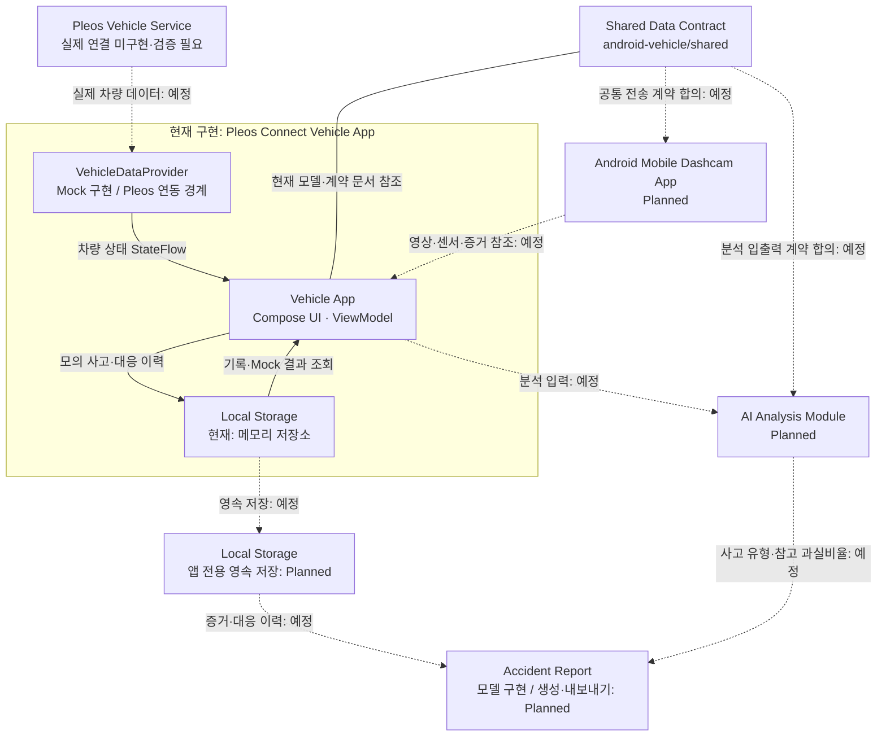
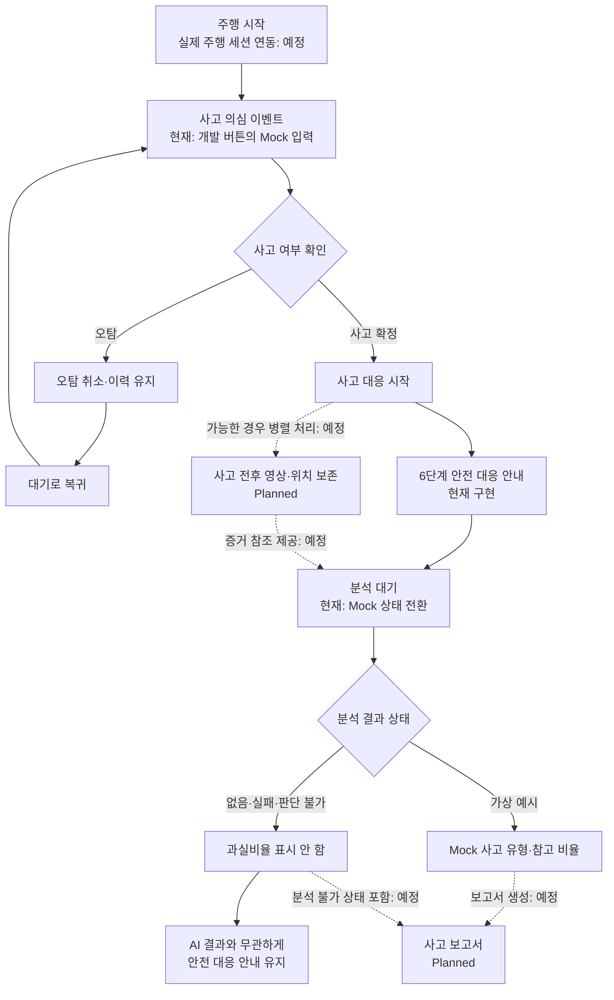

<div align="center">
  <h1>CheckMate</h1>
  <p><strong>사고의 순간, 확인부터 대응까지.</strong></p>
  <p>AI 기반 교통사고 감지 및 대응 보조 서비스</p>
  <p>Hyundai Motor Group App Development Challenge 참가 프로젝트</p>
  <p>
    
    
    
    
    
  </p>
</div>

> **현재 단계: Phase 1 기반 구현 완료 — Mock 기반 차량 앱 프로토타입.** 실제 차량 연결, 스마트폰 녹화, 센서 기반 사고 감지, AI 추론은 아직 연동되지 않았습니다. 아래 개발 상태는 `vehicle-app` 브랜치 기준이며, 실제 차량에서 검증된 안전 기능이나 출시 버전을 의미하지 않습니다.

**목차**

[Project Overview](#project-overview) · [Key Features](#key-features) · [System Architecture](#system-architecture) · [Accident Response Workflow](#accident-response-workflow) · [Tech Stack](#tech-stack) · [Repository Structure](#repository-structure) · [Development Status](#development-status) · [AI Development Plan](#ai-development-plan) · [Installation & Build](#installation--build) · [Testing](#testing) · [Team & Collaboration](#team--collaboration) · [Safety & Limitations](#safety--limitations) · [Roadmap](#roadmap) · [License & References](#license--references)

## Project Overview

CheckMate는 **Pleos Connect 차량용 앱, 스마트폰 블랙박스, AI 사고 분석 모듈을 연결하는 교통사고 대응 보조 서비스**를 목표로 합니다. 평상시의 주행 기록부터 사고 의심 상황의 확인, 사고 정보 보존, 안전 대응, 사후 기록까지 하나의 흐름으로 연결하고자 합니다.

교통사고 직후 운전자는 당황한 상황에서도 탑승자 안전, 주변 교통과 2차 사고 위험, 신고, 증거 확보, 보험사 연락을 판단해야 합니다. 블랙박스 영상이 남아 있어도 필요한 조치의 순서와 보존된 기록을 확인하는 과정은 별도로 필요합니다. CheckMate는 영상 기록에 대응 절차 안내를 연결하여 이 부담을 줄이는 것을 지향합니다.

| 구성 요소 | 담당 역할 | 현재 범위 |
| --- | --- | --- |
| 차량용 앱 | 차량 상태 표시, 사고 확인, 안전 대응 안내, 기록 확인 | Compose 화면·상태 관리·Mock 시나리오 구현 |
| 스마트폰 앱 | 주행 영상 녹화, 센서 기반 의심 상황 감지, 사고 전후 증거 보존 | 향후 구현·연동 예정 |
| AI 분석 모듈 | 사고 유형과 예상 과실비율을 참고 정보로 제공 | 데이터·모델 검토 계획, 현재 고정 Mock 예시만 표시 |

AI 결과는 사고 이후 판단을 돕기 위한 참고 정보로 설계하며, 법적 판단이나 보험사의 과실 확정을 대신하지 않습니다.

## Key Features

상태는 코드 구현과 실제 환경 검증을 구분합니다. `Implemented`도 기기·차량 검증 완료를 뜻하지 않습니다.

| 상태 | 의미 |
| --- | --- |
| Implemented | 현재 브랜치에 로직 또는 기능이 구현됨 |
| Mock Implemented | 가상 입력·고정 예시로 동작하는 기능이 구현됨 |
| In Progress | 개발을 진행 중이며 구현·검증을 마치지 않은 작업 |
| Planned | 구현 또는 실제 연동 예정 |
| Verification Required | 구현 여부와 별도로 실제 환경 검증이 필요함 |

| 기능 | 상태 | 현재 구현 범위 |
| --- | --- | --- |
| 스마트폰 블랙박스 영상 녹화 | Planned | CameraX 녹화·스마트폰 연결 미구현 |
| 사고 의심 상황 감지 | Mock Implemented | 개발 버튼으로 이벤트 생성. 실제 센서·AI 감지는 예정 |
| 사고 전후 영상 및 위치 정보 보존 | Planned | `Evidence` 파일 참조·메타데이터 모델만 정의, 실제 수집·보존 없음 |
| 사고 확인 및 오탐 취소 | Mock Implemented | UUID·발생 시각·연결 스냅샷 기록, 확인·취소·상태 전환 구현 |
| 사고 대응 단계별 가이드 | Implemented | 6단계 안전 안내와 순서별 확인 처리. 화면 런타임 검증 필요 |
| 보험사 접수 지원 | Planned | 직접 연락하도록 안내하는 문구만 제공. 연결·자동 접수·전송 없음 |
| AI 사고 유형 및 예상 과실비율 분석 | Mock Implemented | 개발자가 선택한 고정 가상 예시와 결과 없음·분석 실패·판단 불가 상태 표시 |
| 사고 기록 및 보고서 관리 | Mock Implemented | 모의 사고의 메모리 기록 화면과 보고서 모델 구현. 영속 저장·보고서 생성·내보내기는 예정 |

실제 Pleos SDK 연동은 초기화·종료를 분리할 수 있는 **Provider 경계까지만 구현**했습니다. 기본 Pleos Provider는 미연동 상태를 반환하며, 전용 에뮬레이터 검증도 남아 있습니다.

## System Architecture



**실선은 현재 앱 내부의 상태 전달·메모리 기록 또는 계약 문서 참조, 점선은 향후 연동 경로**입니다. 현재 구현된 앱 간 통신이나 외부 AI 호출은 없습니다. `AccidentReport` 모델 정의와 실제 보고서 생성 기능도 구분합니다.

차량 앱은 `VehicleDataProvider`·`AccidentRepository` API와 ViewModel을 통해 UI·데이터·상태 전환을 분리했습니다. Mock 입력을 실제 SDK 어댑터로 교체할 수 있도록 구성하고, 연결 실패·미지원·데이터 없음 상태를 별도로 다룹니다.

모든 사고 하위 기록은 UUID인 `eventId`로 연결합니다. 시각의 공통 표현은 UTC 기반 ISO 8601이며, 영상은 JSON 바이너리 대신 파일 참조와 메타데이터로 표현합니다. 현재 계약은 [공통 데이터 계약 초안](android-vehicle/shared/README.md)에 정리되어 있고, 전송 API와 팀 간 계약 확정은 후속 작업입니다.

## Accident Response Workflow

아래는 **현재 Mock 흐름과 향후 연동을 함께 표시한 목표 흐름**입니다.



안전 안내와 증거 보존을 병렬로 진행하는 것은 후속 통합 설계입니다. 현재 앱에는 실제 증거 보존·AI 추론·보고서 생성이 없으며, 안전 안내는 AI 결과를 기다리지 않고 제공합니다. 분석할 수 없으면 임의의 과실비율을 만들지 않습니다.

현재 안전 가이드는 **탑승자 안전 → 주변 교통·2차 사고 위험 → 긴급 신고 안내 → 영상·위치 기록 확인 → 보험사 연락 안내 → 사고 기록 확인** 순서입니다. 각 버튼은 안내를 읽었다는 표시이며, 실제 신고나 증거 보존·보험 접수 완료를 확인하지 않습니다.

## Tech Stack

### 현재 차량용 앱

| 영역 | 기술·설정 |
| --- | --- |
| Language / Runtime | Kotlin Compose plugin 2.2.10, Java 17 |
| UI | Jetpack Compose, Material 3, Compose BOM 2026.02.01 |
| Architecture | MVVM, ViewModel, StateFlow, Kotlin Coroutines 1.9.0 |
| Android SDK | minSdk 28 / compileSdk 37 / targetSdk 35 |
| Vehicle SDK | `ai.pleos.playground:Vehicle:2.3.2` — 의존성 및 연동 경계, 실제 연결 미구현 |
| Build | Gradle Wrapper 9.5.0, Android Gradle Plugin 9.3.3, Gradle Kotlin DSL |
| Test | JUnit 4, kotlinx-coroutines-test, Android Lint |
| App Version | 0.1.0 |

버전의 원본은 [앱 빌드 설정](android-vehicle/app/build.gradle.kts), [Version Catalog](android-vehicle/gradle/libs.versions.toml), [Gradle Wrapper 설정](android-vehicle/gradle/wrapper/gradle-wrapper.properties)입니다.

### 개발 및 협업

Android Studio, VS Code, Codex, Git, GitHub를 사용합니다. 기능 브랜치에서 개발하고 Pull Request와 Code Review를 거쳐 통합하는 방식으로 협업합니다.

### 향후 적용 후보

| 영역 | 예정 기술 | 현재 상태 |
| --- | --- | --- |
| Mobile Dashcam | CameraX, Android Sensors | 구현·연동 예정 |
| AI 학습·평가 | Python, PyTorch, AI-Hub 교통사고 영상 데이터 | 데이터 이용조건·모델 구조 검토 예정 |
| AI 모델 | 사고 유형 분류 Baseline, YOLO 기반 객체 탐지, XGBoost 등 | 후보이며 최종 구조 미확정 |

## Repository Structure

`vehicle-app` 브랜치의 현재 추적 파일 구조입니다. 빌드 산출물과 IDE 로컬 설정은 생략했습니다.

```text
CheckMate/
├── android-vehicle/
│   ├── app/
│   │   ├── build.gradle.kts
│   │   └── src/
│   │       ├── main/java/com/whitebearcode02/checkmate/vehicle/
│   │       │   ├── MainActivity.kt
│   │       │   ├── data/             # Provider·메모리 Repository
│   │       │   ├── domain/           # 공통 모델·상태 머신·안전 정책
│   │       │   ├── viewmodel/        # 화면 상태·사용자 명령
│   │       │   └── ui/               # 화면·컴포넌트·테마
│   │       ├── test/                 # JVM 단위 테스트
│   │       └── androidTest/          # Instrumentation 테스트 소스
│   ├── docs/                        # Phase 1 보고·SDK 경계·런타임 검증표
│   ├── shared/                      # 현재 공통 데이터 계약 초안
│   ├── gradle/                      # Wrapper·Version Catalog
│   ├── build.gradle.kts
│   ├── settings.gradle.kts
│   └── gradlew.bat
├── README.md
└── .gitignore
```

`android-mobile/`, `ai-model/`, 최상위 `shared/`·`docs/`는 **현재 브랜치에 없는 계획 구조**입니다. 특히 현재 계약은 최상위 `shared/`가 아닌 **`android-vehicle/shared/`**에 있습니다. 향후 통합 시 공통 계약과 문서 위치를 팀에서 합의할 예정입니다.

## Development Status

아래 이력은 현재 브랜치의 코드와 Git 기록을 기준으로 하며, 다른 팀 브랜치의 미확인 작업을 완료로 간주하지 않습니다.

| Phase | 상태 | 범위·완료 기준 |
| --- | --- | --- |
| Phase 0 — Development Environment | Implemented | Android Studio 프로젝트, Kotlin·Compose, Pleos SDK 의존성, Gradle 빌드 확인 |
| Phase 1 — Foundation | Mock Implemented | MVVM, 공통 모델, Mock Provider, Pleos Provider 경계, 확인·오탐, 6단계 가이드, 메모리 기록, Mock AI 화면, 안전·보안 정책, 단위 테스트 완료 |
| Phase 2 — Pleos Integration | Planned | 실제 SDK 초기화·차량 데이터 조회 구현, 전용 에뮬레이터 검증 필요 |
| Phase 3 — Mobile Dashcam | Planned | CameraX 녹화, 센서 기반 의심 감지, 사고 전후 영상 보존 |
| Phase 4 — AI Analysis | Planned | 데이터 전처리, 사고 유형 분류, 참고 과실비율 추정, 성능 평가 |
| Phase 5 — Integration & Release | Planned | 앱 간 연동, 사고 보고서, 통합 테스트, 공모전 시연 앱·릴리스 |

Phase 0 설정 이력은 [`317c186`](https://github.com/WhiteBearCode02/CheckMate/commit/317c186), Phase 1 기반 구현은 [`a5858da`](https://github.com/WhiteBearCode02/CheckMate/commit/a5858da2f63c5160af7f2c7207a0deb16956718a)에서 확인할 수 있습니다. Phase 1은 로컬 빌드·JVM 검증 기준이며, Pleos 및 Compose 화면 런타임은 **Verification Required**입니다.

## AI Development Plan

### 데이터와 전처리 계획

[AI-Hub 교통사고 영상 데이터](https://aihub.or.kr/aihubdata/data/view.do?currMenu=115&dataSetSn=597&topMenu=100)를 활용 후보로 검토합니다. 사고 영상, 사고 유형, 사고 장소·상황, 차량 진행 정보, A/B 과실비율 라벨, 필요 시 날씨·도로 조건을 활용할 계획입니다. 현재 이 저장소에 해당 데이터나 학습된 모델을 포함하지 않았습니다.

데이터는 개별 이용조건·신청 승인·재배포 조건을 확인한 후 사용합니다. 영상 속 얼굴·차량번호 등 개인정보 처리와 라벨의 의미·누락 여부를 먼저 검토하고, 같은 사고의 인접 프레임이 학습·평가 집합에 섞이지 않도록 사고 단위 분할을 계획합니다.

### 모델 후보와 평가

| 작업 | 모델·방법 후보 | 평가 계획 |
| --- | --- | --- |
| 사고 유형 분류 | 분류 Baseline, 이후 영상·상황 특징 결합 검토 | Macro-F1, Precision / Recall, Confusion Matrix |
| 사고 관련 객체 탐지 | YOLO 기반 탐지 후보 | 객체·상황 특징의 유효성 검증, 분류 성능과 함께 비교 |
| 참고 과실비율 추정 | XGBoost 등 구조화 특징 기반 예측 후보 | MAE, 사고 유형·상황별 오차 분석 |

모델 구조와 입력 특징은 아직 확정되지 않았습니다. 먼저 Baseline을 만들고 클래스 불균형, 라벨 품질, 데이터 누수, 판단 불가 처리 기준을 평가할 계획입니다. **현재 학습 성능·정확도·실제 추론 결과는 없으며, 앱의 Mock 수치는 성능 지표가 아닙니다.**

## Installation & Build

### 개발 환경

- Windows, JDK 17, Android SDK Platform 37, Android Studio 또는 VS Code
- 저장소에 포함된 Gradle Wrapper 9.5.0 사용
- 앱 설정: minSdk 28 / compileSdk 37 / targetSdk 35
- Android Studio에서 SDK 경로를 설정하거나 로컬 `local.properties`에 환경에 맞는 경로 지정. 이 파일은 커밋하지 않습니다.

현재 기반 구현은 `vehicle-app` 브랜치에 있으므로 빌드 전에 해당 브랜치를 선택합니다.

```powershell
git clone https://github.com/WhiteBearCode02/CheckMate.git
cd CheckMate
git switch vehicle-app
cd android-vehicle
.\gradlew.bat assembleDebug
```

Debug APK 경로는 `android-vehicle/app/build/outputs/apk/debug/app-debug.apk`입니다. Debug 빌드는 Mock Provider와 개발용 시나리오를 사용합니다. 비개발 빌드의 Pleos Provider는 현재 미연동 상태이며 실제 차량 연결을 수행하지 않습니다.

의존성은 설정된 공개 Maven 저장소에서 받습니다. 현재 앱은 클라우드·유료 API·보험사 전송을 사용하지 않습니다.

### Pleos 실행 환경

실제 Vehicle SDK 기능은 **Pleos Connect 전용 Emulator 또는 지원 차량 환경**이 필요합니다. 일반 Android Emulator에서 Mock UI를 실행하더라도 실제 Vehicle SDK 기능을 검증한 것으로 볼 수 없습니다. 전용 Emulator의 하드웨어·설치 조건을 확인하고 별도 검증 PC에서 테스트할 예정입니다.

공식 [Emulator 설정 안내](https://document.pleos.ai/en/docs/connect/guide/getting-started/application-development/setup-connect-sdk-emulator)와 프로젝트의 [런타임 검증표](android-vehicle/docs/PHASE1_RUNTIME_CHECKLIST.md)를 참고하세요.

## Testing

**검증 기준일: 2026-10-30 · 기준 소스: `vehicle-app`의 [`a5858da`](https://github.com/WhiteBearCode02/CheckMate/commit/a5858da2f63c5160af7f2c7207a0deb16956718a)**

아래 수치는 [Phase 1 구현 보고서](android-vehicle/docs/PHASE1_REPORT.md)에 기록된 결과를 로컬 XML·APK 산출물과 대조한 것입니다. 검증 범위는 JVM·Debug 빌드·정적 검사이며, 실제 차량 연결이나 화면 런타임을 포함하지 않습니다.

| 검증 항목 | 결과 |
| --- | --- |
| JVM 단위 테스트 | 49개 통과, 실패·오류·건너뜀 0 — 새 테스트 48개 + 기존 1개 |
| Debug APK | 빌드 성공 |
| Android Lint | 오류 0개, 경고 17개 |
| 공통 계약 JSON 예시 | 3개 파싱 성공 |
| 최종 Manifest | `INTERNET`·`CAR_DRIVE`·`CAR_LIGHTS`·`CONTROL_*`/`PRIVATE_*` 권한 없음, 백업·평문 통신 차단 확인 |
| Pleos Emulator·실기기 | 미수행 — Verification Required |
| Compose 화면 시각·상호작용 검증 | 미수행 — Verification Required |

테스트는 Mock 정상·실패·값 없음·미지원, 사고 이벤트 생성과 ID 중복 방지, 오탐 복귀, 순차 대응 안내, AI 결과 없음, 주행·불명 상태의 상세 화면 제한, Provider 종료 처리를 포함합니다. Lint 경고는 버전 업데이트 권고·미사용 리소스 등을 포함하며 상세 내역은 보고서에 남겨 두었습니다.

재검증 명령:

```powershell
cd android-vehicle
.\gradlew.bat testDebugUnitTest
.\gradlew.bat assembleDebug
.\gradlew.bat lintDebug
```

명령은 저장소 루트 기준입니다. 이전 단계에서 이미 `android-vehicle/`에 있다면 첫 줄을 생략합니다. 검증한 환경의 임시 컴파일 옵션과 산출물 경로는 [Phase 1 보고서](android-vehicle/docs/PHASE1_REPORT.md#검증-결과)에 있습니다. 테스트·빌드 설정이 변경되면 위 날짜·커밋·수치를 함께 갱신합니다.

## Team & Collaboration

CheckMate는 역할을 나누어 개발하는 **3인 팀 프로젝트**입니다.

| 역할 | 담당 업무 |
| --- | --- |
| PM / Vehicle App Developer | 기획·일정·공통 계약 조율, 차량 앱 아키텍처·화면·Pleos 연동 |
| Mobile App Developer | 스마트폰 블랙박스, 녹화·센서 감지·증거 보존 |
| AI / Machine Learning Developer | 데이터 전처리, 모델 학습·추론·평가 |

| 브랜치 | 운영 목적 |
| --- | --- |
| `main` | 통합·안정화·릴리스 기준 |
| `vehicle-app` | 차량 앱 및 PM 관련 개발 |
| `mobile-app` | 스마트폰 블랙박스 개발 |
| `ai-model` | AI 데이터·모델 개발 |

협업 흐름은 **기능 개발 → Commit → Pull Request → Code Review → `main` Merge → 검증 후 Release**입니다. 현재 Phase 1 작업은 [PR #2](https://github.com/WhiteBearCode02/CheckMate/pull/2)에서 확인할 수 있습니다. PR 생성·리뷰·병합 상태와 실제 릴리스 여부는 GitHub 이력에서 확인합니다.

커밋 메시지는 Conventional Commits 형식을 사용합니다. 기능을 추가할 때는 공통 `eventId`, 데이터 출처, 실패 상태와 테스트 범위를 함께 검토합니다.

## Safety & Limitations

- 예상 과실비율은 참고 정보이며 법적 판단이나 실제 과실 확정이 아닙니다. 현재 화면의 비율은 명시적으로 선택한 Mock 예시입니다.
- 실제 사고 감지·녹화·증거 보존은 미구현이며, 검증 전까지 사고 예방·탐지·대응을 보장하는 안전 기능으로 사용할 수 없습니다.
- 긴급 신고와 보험사 연결·자동 접수·외부 전송은 구현하지 않았습니다. 안전 가이드 확인 버튼도 실제 조치 완료를 의미하지 않습니다.
- 차량 데이터 접근은 SDK·서비스 버전, 지원 기능, 권한과 실제 환경 검증에 종속됩니다. 실제 충돌 신호를 제공한다고 가정하지 않으며 차량 제어 기능은 구현하지 않았습니다.
- 상세 기록·AI 화면은 연결 정상·정차 확인·오류 없음 조건에서만 허용합니다. 주행·정차 불명·속도 모순 상태는 차단하며, 실제 차량 제한 정책 검증은 남아 있습니다.
- Debug의 Mock 데이터와 실제 데이터 출처를 구분합니다. 스마트폰 연결·녹화 상태를 미연동 상태에서 정상 동작으로 표시하지 않습니다.
- 현재 사고 기록은 **메모리 기반**이므로 앱 프로세스 종료 시 사라집니다. 증거 보관용 저장소나 복구 가능한 사고 보고서가 아닙니다.
- 현재 앱은 원시 위치·영상 수집이나 민감정보 로그 출력을 하지 않으며 백업을 차단합니다. 향후 증거 수집을 도입할 때 앱 전용 저장소, 접근 제어, 보관·삭제 정책을 함께 구현해야 합니다.
- SDK 의존성의 `VEHICLE_BINDING`과 AndroidX signature 권한은 남아 있습니다. 사용하지 않는 차량 권한을 제거했다는 것이 모든 권한이 없다는 뜻은 아닙니다.
- 배포·유료 서비스·외부 개인정보 전송·실제 신고/접수 연동은 비용과 이용조건·책임 범위를 검토하고 별도 동의 후 진행합니다.

## Roadmap

- [x] Phase 0: Android 프로젝트·Kotlin·Compose·Pleos SDK 의존성 설정 및 빌드
- [x] Phase 1: MVVM·공통 모델·Mock Provider·실제 SDK 연동 경계
- [x] Phase 1: 모의 사고 확인·오탐·6단계 안전 안내·메모리 기록·Mock AI 화면
- [x] Phase 1: 안전 정책·최소 권한·JVM 테스트·Debug 빌드·Lint 검증
- [ ] Phase 2: 실제 Pleos SDK 초기화·지원 기능 확인·차량 데이터 조회
- [ ] Phase 2: 전용 Emulator·실기기·Compose 화면 및 운전 제한 검증
- [ ] Phase 3: CameraX 녹화·센서 기반 의심 감지·사고 전후 영상/위치 보존
- [ ] Phase 4: 데이터 이용조건 확인·전처리·Baseline·모델 후보 비교·성능 평가
- [ ] Phase 5: 공통 계약 확정·앱 간 데이터 전달·증거 접근 제어
- [ ] Phase 5: 로컬 영속 저장·사고 보고서 생성 및 내보내기
- [ ] Phase 5: 통합 테스트·공모전 시연·릴리스 준비

## License & References

현재 저장소에는 `LICENSE` 파일이 없으며 별도의 오픈소스 라이선스를 선언하지 않았습니다. MIT·Apache 등 특정 라이선스로 배포된 프로젝트라고 간주하지 마세요. 코드, SDK, 데이터셋의 이용·재배포 조건은 각각 확인해야 합니다.

공식 참고자료는 2026-10-30에 접근을 확인했습니다.

- [Pleos Developer Portal](https://developers.pleos.ai/playground)
- [Pleos Vehicle SDK Documentation](https://document.pleos.ai/en/docs/pleos-only/connect-sdk-pleos/Vehicle/intro)
- [Pleos Connect Emulator Setup](https://document.pleos.ai/en/docs/connect/guide/getting-started/application-development/setup-connect-sdk-emulator)
- [AI-Hub](https://aihub.or.kr/) · [교통사고 영상 데이터](https://aihub.or.kr/aihubdata/data/view.do?currMenu=115&dataSetSn=597&topMenu=100)
- [Hyundai Motor Group App Development Challenge](https://appdevchallenge.auto-hmg.io/)

구현·검증 근거: [Phase 1 보고서](android-vehicle/docs/PHASE1_REPORT.md) · [Pleos 연동 경계](android-vehicle/docs/PLEOS_INTEGRATION.md) · [런타임 검증표](android-vehicle/docs/PHASE1_RUNTIME_CHECKLIST.md) · [공통 데이터 계약](android-vehicle/shared/README.md)
