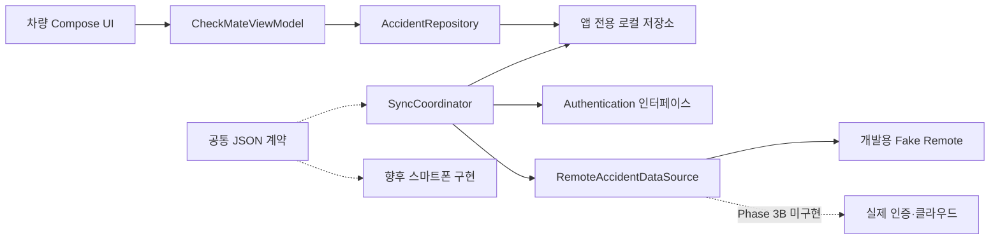

# 차량·스마트폰 연동 아키텍처 — Phase 3A

기준일: 2026-10-31. 이 문서는 구현된 차량 앱과 개발용 Fake 검증, 향후 실제 연동을 구분한다. 스마트폰 앱 전체 개발이나 클라우드 운영을 이번 단계의 완료 범위로 간주하지 않는다.

## 서비스 역할

CheckMate는 교통사고 직후 필요한 조치를 안내하고, 차량과 스마트폰에서 같은 사고 처리 과정을 이어가며, 영상 기반 예상 과실비율을 참고하도록 돕는 서비스다. 공식 아이콘의 로봇·차량·사고 기록·연락 요소는 사고 순간의 스마트 대응 파트너를 뜻한다.

| 영역 | 역할 | Phase 3A 경계 |
| --- | --- | --- |
| 차량 앱 | 차량 상태, 수동 사고 확인, 안전 안내, 대응 단계·기록 저장, 분석 결과 요약 | 기존 화면·Pleos Door 읽기·명시적 Mock 선택을 유지하고 로컬 영속 저장과 동기화 인터페이스를 연결 |
| 스마트폰 앱 | 동일 사고 조회, 수동 신고, 현장 사진·영상, 보험사 연락, 상세 분석·보고서 | 공통 계약과 Fake 두 기기 시나리오를 제공하며 실제 모바일 화면·인증·연결은 담당자 후속 작업 |
| AI 영역 | 영상 입력 분석, 사고 유형·근거·참고 과실비율 제공 | 실제 모델·영상 업로드·분석 서버 미연동. Mock 결과와 실제 추론을 구별 |
| 공통 백엔드 | 인증된 사용자 범위에서 사고 메타데이터 공유 | 실제 서버 없음. Fake Auth·Fake Remote만 검증하며 외부 전송은 활성화하지 않음 |

스마트폰 블랙박스는 선택 기능이다. 녹화를 사용하지 않아도 수동 사고 신고·기본 대응 안내·기존 영상 기반 분석 요청의 향후 설계를 사용할 수 있어야 한다. 이 원칙은 실제 녹화나 영상 분석 기능을 구현했다는 뜻이 아니다.

## 데이터 경계

UI는 저장 파일이나 Remote를 직접 호출하지 않는다. 기존 `AccidentRepository`의 사고 의심·확인·오탐 취소·안내 확인·분석 API와 개발용 `InMemoryAccidentRepository`를 유지한다. 동기화는 별도 `AccidentSyncStore`의 로컬 버전 비교 후 반영 API를 사용한다.

공통 사고 키는 기존 `eventId` UUID를 유지한다. `DataSource.MOCK/PLEOS`는 관측 데이터 출처, `EventOrigin`은 사고 생성 경로이며 서로 대체하지 않는다. 예를 들어 수동 생성된 차량 사고는 `origin=VEHICLE_MANUAL`이면서 관측 출처가 `PLEOS`일 수 있다. Pleos 자료가 없는 항목은 `null`·`UNKNOWN`으로 남긴다.

원본 영상·파일 URI·GPS·자격 증명은 공통 `AccidentRecord`에 포함하지 않는다. `EvidenceMetadata`만으로 파일이 기기에 존재하거나 업로드 동의가 있다고 판단할 수 없다. 실제 파일 접근·전송은 향후 인증·동의·비공개 저장소·보존 정책을 갖춘 별도 API에서 구현한다.

## 안전과 오프라인

- 네트워크·SDK 실패와 무관하게 기본 사고 대응 안내에 접근할 수 있다. 기록 생성·대응 단계는 로컬에서 처리한다.
- 상세 기록·AI 화면의 `DrivingSafetyPolicy`를 보존한다. 정차 정보가 없거나 만료됐으면 제한하며 사고 스냅샷의 과거 `PARKED`를 현재 주차 증명으로 사용하지 않는다.
- 실제 Pleos 어댑터는 Door 읽기 범위다. Door 열림·닫힘을 정차·속도·탑승자 안전의 증거로 해석하지 않는다.
- 앱 재시작 후 차량 연결·정차 신뢰는 새 관찰로 확인한다. 저장된 사고 이력을 읽었다는 이유로 현재 안전 제한을 해제하지 않는다.
- Fake Remote의 성공은 실제 스마트폰·차량 간 통신 성공이 아니다. 실제 네트워크 장애·복구는 Phase 3B에서 별도로 검증한다.

## 인증·보안·비용

개발용 인증은 프로세스 내부 테스트 권한을 검증하는 Fake다. 클라이언트가 보낸 `userId`만으로 다른 사용자 사고를 읽거나 수정하지 않도록 Remote 경계에서 세션을 확인한다. 실제 인증 제공자·토큰 수명·차량 계정 연결 방식은 미정이며 Fake 권한을 운영 보안으로 재사용하지 않는다.

Firebase Authentication·Cloud Firestore는 후보 기술이다. SDK 의존성·프로젝트·키·과금 계정·외부 전송을 이번 작업에서 활성화하지 않는다. Phase 3B 착수 전 차량 환경 지원, 인증·DB 보안 규칙, 사용자 동의와 비용 조건을 확인하고 소유자의 승인을 받는다. QR 연결도 현재 구현된 기능이 아니다.

사고 내용·위치·파일 URI·보험사 개인정보·인증 토큰은 로그와 예외 원문으로 내보내지 않는다. 앱 전용 저장소와 백업 제한은 기기 보안의 일부이며 루팅·물리 접근·분실 기기까지 해결하는 암호화 보장을 뜻하지 않는다.

## 확인한 Git·문서 근거

읽기 전용 GitHub API 확인 시점의 로컬·원격 `vehicle-app`은 `54f7164b1723d5ee78f218fede3b1299977f9cfb`, 원격 `main`은 `c9a5ed6053308624ce47b93877a84fbbed61fcd7`이었다. `vehicle-app`은 `main` 대비 ahead 1 / behind 3, 공통 조상은 Phase 2의 `b21967e3f6d55aa686229aa496388074d77dd0b2`다. 반대 비교의 변경 파일 목록은 비어 있었고 차량 브랜치의 별도 커밋은 공식 아이콘 변경이었다. 기존 README 수정·원본 아이콘 미추적 상태를 보존하기 위해 자동 병합하지 않았다.

- [PR #1 초기화](https://github.com/WhiteBearCode02/CheckMate/pull/1): 2026-10-30 00:21:29 KST 병합.
- [PR #2 Phase 1](https://github.com/WhiteBearCode02/CheckMate/pull/2): 2026-10-30 02:37:05 KST 병합.
- [PR #3 Phase 2](https://github.com/WhiteBearCode02/CheckMate/pull/3): 2026-10-30 14:22:41 KST 병합.

요청된 데이터구조·기능명세서 v2.0, 기능개발·브랜치 워크플로우 v2.0, Pleos Connect 개발준비 가이드 v2.0, GitHub·PR·코드리뷰 가이드 v2.1, 공모전 참가자 통합가이드 v1.1, 공모전 기획내용 개정안 v3.0, 차량·스마트폰 DB 연동설계서 v1.0은 로컬 저장소 및 원격 `main`·`vehicle-app`·`mobile-app`에서 확인하지 못했다. 해당 문서를 읽었다고 전제하지 않고 사용자 요구사항·현재 코드·기존 Phase 1·2 문서를 기준으로 설계했다.

## 팀별 후속 작업

| 담당 | 전달 사항 |
| --- | --- |
| 차량 | Repository 경계, 프로세스 재시작 복원, 정차 미확인 제한, 실제 Pleos 권한·에뮬레이터 검증 유지 |
| 스마트폰 | [공통 계약](../../shared/contracts/README.md)의 `eventId`·소유권·버전·tombstone을 사용. 녹화는 선택 기능이며 파일과 메타데이터를 분리 |
| AI | 입력 파일 접근 권한·동의와 결과 출처를 별도 계약. 현재 `DataSource`를 실제 AI 제공자로 임의 재사용하지 않고 모델 버전·실패·판단 불가·한계를 합의 |
| 백엔드·공동 | 인증 주체 기반 사용자 격리, 원자적 revision 비교, 재전송 멱등성, 충돌 해결·삭제 보존·접근 제어를 실제 서버에서 검증 |

구체적인 저장·동기화 규칙은 [DB 설계](database-design.md), [동기화 정책](sync-policy.md), 실행 검증 결과는 [Phase 3 보고서](../../android-vehicle/docs/PHASE3_REPORT.md)에 기록한다.
